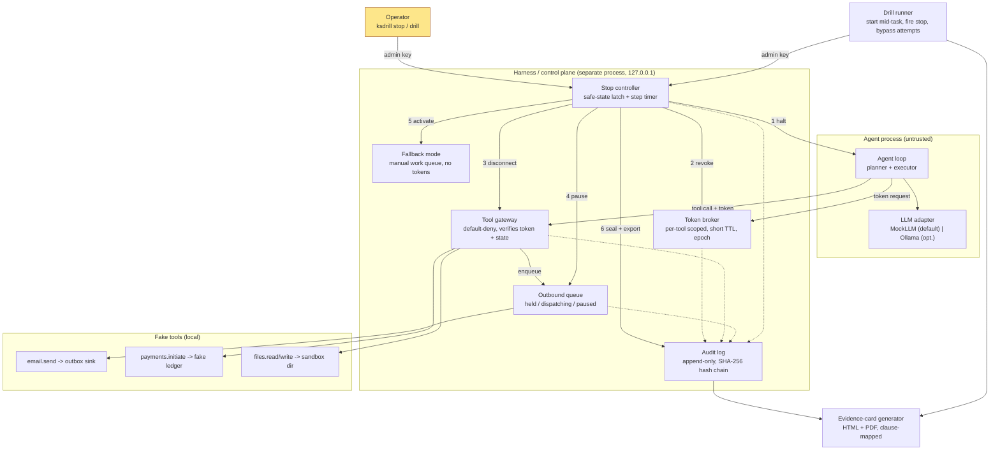

# Architecture

An untrusted agent process can reach the world only through a separate harness. The harness issues a short-lived token per tool, gates every call, and queues every outbound message. The stop controller in that harness latches a persisted safe state and then runs the six HKMA steps in order, timing each one. Every component writes to a hash-chained log. The evidence card is built from that log.

## Processes

| Process | Started by | Holds | Can reach |
| --- | --- | --- | --- |
| Harness (`ksdrill harness up`) | Operator or the drill runner | Signing key, admin key, state, the only log writer | Tool adapters, in-process |
| Agent (`ksdrill agent start`) | Launcher, own process group | Agent id, bootstrap key, short-lived tokens in memory | `http://127.0.0.1:8701` only |
| Operator CLI / drill runner | The person running the demo | Admin key in `runs/<id>/secrets/admin.key` (mode 0600) | `http://127.0.0.1:8702` |

The launcher builds the agent environment from an allow-list. Names starting with `KSD_ADMIN` are refused. The agent package does not import the harness.

## Gateway order

Every tool call is decided in this order, and every decision is logged:

1. Latch set → `409 HALTED`
2. Unknown tool or action → `404 DENY_UNKNOWN`
3. Token → `401 TOKEN_INVALID`, `TOKEN_REVOKED`, `TOKEN_EXPIRED`, or `403 SCOPE_MISMATCH`
4. Policy (allow-list, payment cap) → `403 POLICY_DENY`
5. Adapter disconnected → `503 TOOLS_DISCONNECTED`
6. Dispatch. Outbound tools return `202 QUEUED`.

Arguments are stored as a SHA-256 digest. The token string is not stored in the log; the `jti` is.

## What is deliberately small

One log writer, JSONL, no search, no SIEM export, no policy language, no admin UI. A production gateway or ledger would be a different product. This repository is the drill.
